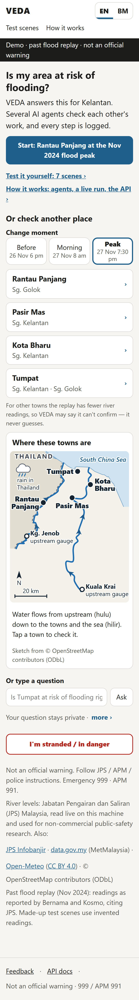
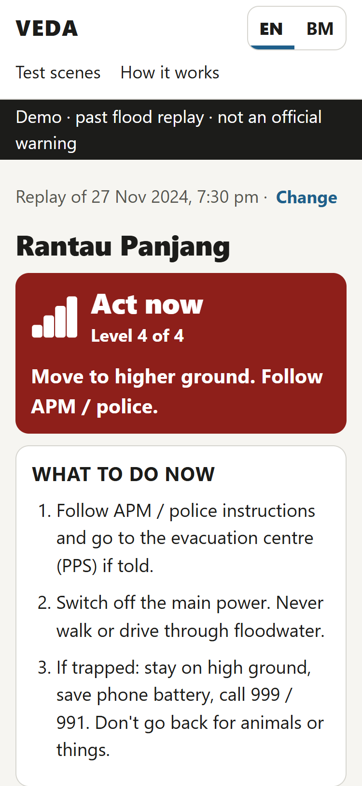
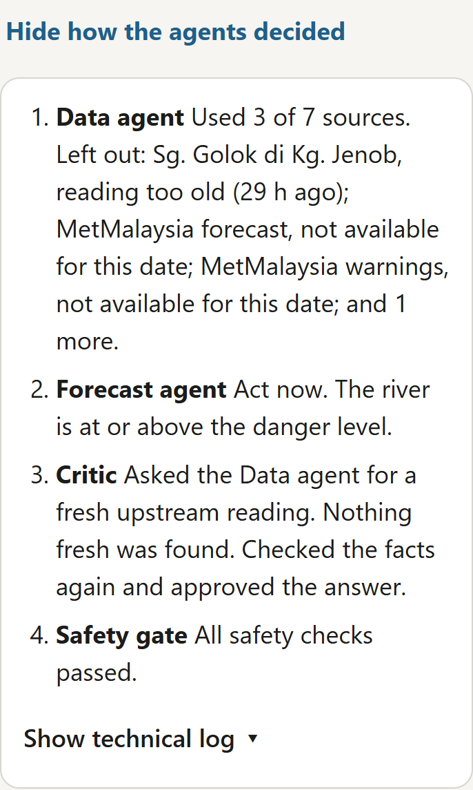
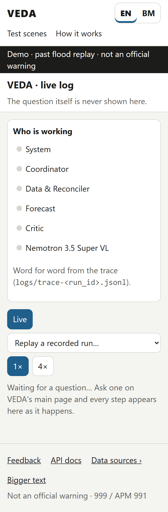
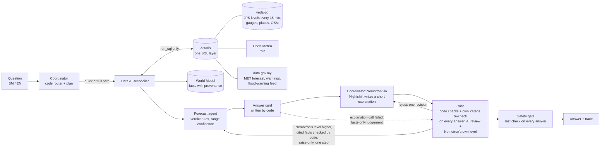

# VEDA — Vast Earth Data Analyser

> **For judges, in 2 minutes**
> - **What it is:** VEDA tells you whether a place in Kelantan is at risk of flooding; several agents check each other's work, and every step is logged.
> - **Install + run (one line):** Windows `.\install.ps1` · Mac/Linux `./install.sh` - then open http://127.0.0.1:8000 (the offline demo with no keys; live with Zetaris + Nightshift).
> - **Stuck?** `python -m veda doctor` · **Install with your AI:** [docs/INSTALL_WITH_AI.md](docs/INSTALL_WITH_AI.md)
> - **Try it with no keys** (offline sample mode, after `pip install -r requirements.txt`): `python -m veda ask "Is Rantau Panjang at risk of flooding?"`
> - **Public demo:** see the submission form (its address is not kept in this repo).
> - **How it decided:** each run's trace is `logs/trace-<run_id>.jsonl`; the web page's **How it works** (`/how-it-works`) replays recorded live runs step by step.
> - **Meterless World Model test:** `python -m pytest tests/conformance -v` - 8/8 conformance checks pass (over 1,000 offline tests in all: `python -m pytest -q`).
> - **Model per AI call:** every AI call's trace line names the model requested and the model that answered, with its Nightshift receipt - see [AI and Model Usage](#ai-and-model-usage).

**Team Hujung Lab** (Mohd Husaini Mohd Fauzi, Muhammad Ariff Baharudin) · GenAI Works Open Agent Hackathon 2026 ·
Track: Solving Fragmented Intelligence · Machine-readable summary: [`metadata.json`](metadata.json)

> **Judges: [try VEDA in 10 minutes](docs/JUDGES.md)** - offline, no keys, no Docker: three commands, then eight things to
> try (the Nov 2024 flood replay, a calm day, rain raising the alarm, a broken source, how the agents worked it out,
> the agents' live log, the Critic asking for more data, BM).

VEDA is a multi-agent system for flood-prone Kelantan, Malaysia. Kelantan's flood data is scattered and sometimes
stale or contradictory. VEDA cross-checks it and answers one question for anyone asking about a place, in English or
Bahasa Melayu: **"Is my place at risk in the next 24–48 hours, and what should we do now?"** Every claim in the answer
is traced to its source and its age.

**Approach:** code agents read every source through Zetaris, check and reconcile it, and decide the verdict with
plain, reviewable rules. NVIDIA Nemotron (through Meterless Nightshift) writes a 1-2 sentence explanation, which a
Critic checks against the facts, and in that check gives its own level: code uses it only to raise the level, by one
step, when the facts it cites support it - never to lower it. The answer card goes out, checked by code, even when
the model is slow or down.

> ⚠️ **Not an official warning. Follow JPS / APM / police instructions. Emergency 999 · APM 991.**
> VEDA is decision support only.

## Quick start for judges (offline, no keys, about 2 minutes)
SAMPLE_MODE runs the real agent logic offline, with no network, no `.env` and no API keys, on **scenes**: the Nov 2024
replay (readings reported in the news, each cited) or a **SYNTHETIC** scene (made-up readings, labelled everywhere).
On the command line and the API, a question without a scene runs on the SYNTHETIC calm day; the web page opens
on the Nov 2024 replay.

**Covered places:** offline scenes - Rantau Panjang, Pasir Mas, Kota Bharu and Tumpat (the Home buttons); live mode
also Kuala Krai, Tanah Merah, Dabong, Wakaf Bharu and Pasir Pekan (added 24 Oct, tentative - Dr Ariff to review their
gauges). In BM or English, common spellings such as "Kota Baru", "Psr Mas". Any other recognised Kelantan place gets
"not covered yet" and the nearest covered place.

**Docker:**
```
docker build -t veda .
docker run --rm -p 8000:8000 -e SAMPLE_MODE=true veda
```
Then open http://127.0.0.1:8000, tap a town or type a question (for example *"Mak ayah saya di Tumpat, kena pindah
malam ni?"*), in English or Bahasa Melayu (EN | BM at the top). Offline, the page opens on the Nov 2024 flood replay at its
peak (27 Nov, 7:30 pm); **Change moment** switches to Before / Morning / Peak, and the made-up test scenes are under
**Test scenes** in the top bar (`/scenes`). "See what VEDA is doing ›" shows each step live while it works.

**Python 3.10+ without Docker** ([JPS reading] recommended; tested on 3.10-3.13):
```
python -m venv .venv
.venv\Scripts\activate                       # macOS/Linux: source .venv/bin/activate
pip install -r requirements.txt
set SAMPLE_MODE=true                         # PowerShell: $env:SAMPLE_MODE="true"  macOS/Linux: export SAMPLE_MODE=true
python run.py "Is Rantau Panjang at risk?"
python run.py --replay nov2024 --at "2024-11-27 19:30" "Rantau Panjang selamat ke?"
python -m app.main                           # the web page on http://127.0.0.1:8000
python scripts/run_evals.py                  # 41 safety scenarios, pass/fail table
python -m pytest -q                          # offline test suite
```
Start the server: with Zetaris + Nightshift it runs live; without them it runs the offline demo automatically. It
checks once at start (keys set, Zetaris and Nightshift answering), logs one line saying why it went offline, and
`/health` shows `"sample_mode": true` with the `"reason"`. A river-data outage while it runs never switches it: it
stays live and answers "Can't confirm right now". The command line (`python -m veda`) also switches to offline sample
mode by itself and says so.

## Try VEDA without the UI (API and command line)
The same agents as the web page (Coordinator → Data & Reconciler → Forecast → Critic → safety gate), as JSON.
Full docs with a filled-in example: **`/api/docs`** (only the three `/api/v1` routes).

**Public demo** (offline sample mode, scenes only; the demo's address is on the submission form - `<tailnet>` below
stands for it):
```
curl -X POST https://wyse5070.<tailnet>.ts.net/api/v1/ask -H "Content-Type: application/json" -d '{"question": "Is Tumpat safe tonight?", "lang": "en"}'
```
**On your computer** (after `python -m app.main` with SAMPLE_MODE=true, or the Docker command above):
```
curl -X POST http://127.0.0.1:8000/api/v1/ask -H "Content-Type: application/json" -d '{"question": "Rantau Panjang selamat ke?", "lang": "bm", "scene": "nov2024"}'
curl http://127.0.0.1:8000/api/v1/scenes
curl http://127.0.0.1:8000/api/v1/health
```
Windows PowerShell: `Invoke-RestMethod -Method Post http://127.0.0.1:8000/api/v1/ask -ContentType application/json -Body '{"question": "Is Tumpat safe tonight?"}'`

**Command line** (no server, no keys needed - with no `.env` it runs offline and says so in one line):
```
python -m veda ask "Is Tumpat safe tonight?"
python -m veda ask "Rantau Panjang selamat ke?" --lang bm --scene nov2024 --json
python -m veda scenes
```
```
Offline sample mode (no keys found): VEDA answers from its recorded and made-up scenes (no live data, no AI calls).
Tumpat: Normal for now (NORMAL)  [SYNTHETIC · calm day]
What to do: Nothing to do now. No action needed. Keep an eye on JPS updates.
Why: The river is 0.62 m below the alert level.
Nemotron's judgement: live mode only
Critic: approved (checked by code, zetaris; 11 code checks)
Steps: Understand the question (Coordinator) · Gather the data (Data & Reconciler) · Work out the risk (Forecast) · ...
Run id: 20261024-224354-360a · mode: offline sample
```
**The answer's fields:** `level`, `level_label` (EN / BM), `what_to_do`, `why`, `facts_used`, `facts_left_out` (with
the reason), `critic_checks`, `ai_judgement` (or "live mode only"), `steps` (one line per agent step), `trail` (what
each agent did, in plain words - the answer's "Why this answer?"), `mode`
("offline sample" | "live"), `run_id`, plus the answer `text` and the disclaimer. `lang` is `en` or `bm`; `scene` is
an id from `/api/v1/scenes` (offline scenes; without one, the SYNTHETIC calm day).

**Limits:** the question is 1-300 characters, the body at most 4 KB; one question at a time (a second gets 429
`busy`); errors are JSON `{"error": {"code", "message"}}` with a 4xx status. The public demo also limits each visitor
(about 20 questions a minute, bursts of 10).

**Running without Nightshift?** By default - no `.env`, no keys - the command line and a server started with
SAMPLE_MODE=true run **offline on the scenes**: the real agent logic, no network, no AI calls; Nemotron's judgement
shows as "live mode only". **Live mode** needs Zetaris keys (river data) and Meterless Nightshift (Nemotron 3.5 Super
VL); VEDA calls Nemotron only through Nightshift. Live without Nightshift still answers: the card is written and
checked by code, and the trace marks the AI fallback.

**Flood replay (the real progression):** choose *REPLAY · Nov 2024* on the page, or use `--replay nov2024`. It
replays the November 2024 Rantau Panjang flood with the JPS readings that news reports quoted at the time (each cited).
Every data source is cut at the replay time, so nothing from later is ever used:

| Scene | What VEDA says for Rantau Panjang |
|---|---|
| 26 Nov 18:00 | PREPARE |
| 27 Nov 08:00 | Can't confirm right now (INSUFFICIENT_DATA: no verified reading near this time, and VEDA will not guess) |
| 27 Nov 19:30 | ACT, 0.1 m above the Dec 2014 peak |

For Pasir Mas, Kota Bharu and Tumpat the replay has no cited river reading, so VEDA says it can't confirm - it never
guesses.

**SYNTHETIC scenes** (`--replay synthetic_rising`, `--replay synthetic_calm`):
- *SYNTHETIC · rising river* is **a made-up stress scenario: synthetic river levels, real archived rain** (Open-Meteo,
  25 Nov 2024). It is not a forecast and not what happened; it shows how VEDA reacts when every gauge climbs at once
  (Rantau Panjang, Pasir Mas and Tumpat ACT, Kota Bharu WATCH).
- *SYNTHETIC · calm day*: synthetic river levels below Waspada, real archived rain (Open-Meteo, 15 Jun 2024); every
  town NORMAL.
- *SYNTHETIC · silent upstream gauge* (`--replay synthetic_silent_upstream`, a made-up test scene): the calm day, but
  three upstream gauges went silent after 04:00 and Temangan is at Amaran and rising. Ask about Pasir Mas: the Critic
  asks the Data & Reconciler for the missing upstream reading, it finds Temangan, and the verdict is recomputed
  NORMAL → WATCH - all in the trace. Ask about Rantau Panjang: nothing further up the Golok, so the card says what is
  missing.
- *SYNTHETIC · upstream rain arriving during local rain* (`--replay synthetic_upstream_rain`, a made-up test scene):
  made-up calm river levels with the **real archive rain of 27 Nov 2024** (Open-Meteo). Ask about Kota Bharu: the
  river is Normal, but heavy rain upstream (Kuala Krai, may reach here in 9-17 h) while it rains heavily in town
  raises the verdict to PREPARE (the B-88 rain rule, tentative).
- All four are made by `scripts/make_synthetic_scenes.py` from cited facts only (each gauge's JPS thresholds, river chain,
  Dec 2014 peaks, travel times) and are labelled SYNTHETIC on the card and in the trace.

## What you get
One short answer card, written by code from checked data, in the user's language. It contains:
- the action to take now;
- the verdict (`NORMAL · WATCH · PREPARE · ACT · INSUFFICIENT_DATA`) and the official JPS level;
- the river level compared with the Alert and Danger levels and the 2014 flood;
- a 24 h range (never one precise number) and a confidence level;
- rain, upstream gauges, MetMalaysia warnings, and every source with its age;
- any source that was excluded, and any disagreement it could not resolve.

On the full path, Nemotron adds a short explanation **when the model replies in time** - not on every answer:
explanation shown in 6 of 7 live full-path runs (24 Oct 2026, 12:19-13:14 MYT, Super VL; all 10 runs answered
within 150 s - [`docs/EVIDENCE-live-24oct.md`](docs/EVIDENCE-live-24oct.md)). It is shown only if the code checks pass
and the Critic's AI review approved it; otherwise the card goes out without it.

**On the web page** the answer opens with the level word, "Level n of 4" and one action line, then WHAT TO DO NOW as
numbered steps, **the river here** on a gauge post (the gauge's own JPS Normal / Alert / Warning / Danger marks, and
the Dec 2014 flood line where the gauge has one), **coming from upstream** (hulu → hilir: the rain area and the
upstream gauges, then "you"), the rain here, and **Send to family on WhatsApp** (level, what to do, who checked it,
when and from what source, a link back - never the question). Numbers and gauge names stay in **Details**.
Under the town list, **"Where these towns are"** is a small sketch map (static, offline, built once from
OpenStreetMap lines by `scripts/make_home_map.py`): Sg. Kelantan and Sg. Golok with arrows downstream, the Thai border
and Thailand, the sea, the two upstream gauges (Kuala Krai, Kg. Jenob) and the four towns - tap a town on the map to
check it, as on its row. In live mode the map shows all nine covered places (south to Dabong on Sg. Galas) and
"Also covered" buttons list the five places that are not Home rows.

| Home | Act now (Nov 2024 peak) | Why this answer? | Live log (replay) |
|---|---|---|---|
|  |  |  |  |

More screens, EN and BM, phone and desktop: [`docs/media/v2/b96/`](docs/media/v2/b96/).
See `input_examples/` and `output_examples/` (6 real runs, each with its full trace).

## How it works

- **One question, one plain state machine** (`app/loop.py`): plan → gather → forecast → draft → critique →
  (revise) → done.
- **Agents that work together:** the Data & Reconciler says which sources it chose and skipped (and why); when the
  Critic finds a gap (a silent upstream gauge), it asks the Data & Reconciler for another source and the verdict is
  recomputed if one is found ("verdict recomputed after the Critic's request: NORMAL → WATCH"); every run, gauges JPS
  publishes that VEDA has not mapped yet are noticed as "discovered" - a person approves one (`python -m app.discover approve <station_key> --place <town> --by <name>`; `list` shows them)
  before it appears, and then only as context, never in the verdict.
- **AI judgement in the loop (Part 7, 24 Oct): code sets a floor, Nemotron can only raise it.** In the same review
  call, the Critic's Nemotron also gives its own level from all the facts and cites up to 2 fact ids. Code then
  decides: a higher level is used only when every cited fact exists and can support a raise and the AI's confidence
  is medium or high - at most one level up, unless a cited fact itself stands higher (e.g. the 24 h range passing
  Danger). A lower AI level is recorded and VEDA keeps the safer level; "Can't confirm" is never changed by the AI.
  A raised answer says "Nemotron weighed all sources and raised this to <level>: <the cited facts, in the words code
  wrote>", Details show "Rules said / Nemotron said / Final", and the AI's level is traced on every full run
  (`critic.ai_judgement`). Offline there is no model, so Details say "Nemotron's judgement: live mode only".
- **Code decides the path.** The quick path (about 6 s, written by code) is used when nothing is wrong. The full path
  (≤150 s, with Nemotron) is used when a gauge is at Alert or above, the river is rising, a MET warning is active, a
  source is stale or missing, or the question is about evacuation, being cut off, or the next days.
- **Every agent step, Zetaris call and model call** writes one JSON line to `logs/trace-<run_id>.jsonl`, and a
  short line per step to stdout (CLI and web server / `docker logs`; the question text is never printed). The web
  page shows the same steps live. See [`logs/README.md`](logs/README.md) and the committed sample traces.
- Module contracts (inputs → outputs → failure behaviour) are in [`docs/how-it-works.md`](docs/how-it-works.md).
  Decisions with dates are in [`docs/DECISIONS.md`](docs/DECISIONS.md).

### The agents
| Agent | Job | Uses AI? |
|---|---|---|
| **Coordinator** (`app/agents/coordinator.py`, `app/router.py`) | Finds the place, picks the answer language, decides quick or full and writes the plan. Writes the short explanation on the full path. | Only for the explanation (Nemotron 3.5 Super VL by name, lane `deep`) |
| **Data & Reconciler** (`app/agents/data_agent.py`) | Fetches every source through Zetaris in parallel and checks freshness and plausibility. Reconciles disagreeing sources (reliability, then recency, else `conflicts_unresolved`). Heals: backup gauge → last reading for context → INSUFFICIENT_DATA. Per-source circuit breaker. | No |
| **Forecast** (`app/agents/forecast_agent.py`) | Applies the verdict rules to the controlling gauges, upstream gauges and rain - including rain **upstream + here** (B-88, `app/rain_rule.py`: heavy rain at an upstream rain point lifts a town to at least Keep watching; when it can arrive within 24 h while it also rains heavily in town, one level up). Builds the 24 h range, the confidence, and the comparison with past floods. | No |
| **Critic** (`app/agents/critic.py`) | **Code + Zetaris re-check on every answer; AI review when the model replies in time.** The code checks cannot be overruled (verdict, numbers, never "go into water", flipped comparisons, reassurance under a warning). The Zetaris re-check re-reads the controlling gauge and the flood-warning feed itself. The AI review (Nemotron 3.5 Super VL via Nightshift) gets only the card's key facts (each with an id) and the explanation, and answers: does the explanation contradict, exaggerate or downplay a fact? - and, in the same call, which level would it give, citing up to 2 fact ids (code accepts only a cited, one-level raise; see "AI judgement in the loop"). Live, **24 Oct 2026, 12:19-13:14 MYT: the AI review was done in 6 of 7 full-path runs** (23 Oct, 22:47-23:07: 8 of 10 full runs; planted-error harness 24 Oct: 5 of 5 answered planted errors rejected - see Evaluations). Any problem means reject and revise once; when the AI review does not complete, the AI explanation is dropped and only the code-checked card is sent. | AI review when it replies in time |
| **Safety gate** (`app/safety.py`) | Last check on every answer: never NORMAL on unusable data, no advice into water, disclaimer with 999 / 991, ranges only, replay title, never "a PPS is open" or "the road will be cut off". | No |

Models are reached only through Meterless **Nightshift**: both AI steps ask for NVIDIA Nemotron 3.5 Super VL **by
name** (`nvidia/nemotron-3.5-super-vl-120b-a12b`) on the deep lane (app `veda-deep`) - never `meterless/auto`, never NVIDIA directly, and Lightning is not
used (since 23 Oct, B-85). Agents get data only through `run_sql()` on **Zetaris**.

### When something fails (every case is a trace line; the answer still goes out)
| What fails | What VEDA does | What the user sees |
|---|---|---|
| Zetaris unreachable / no keys | No guessing: stops after the place lookup | "VEDA cannot reach its river data right now…" + check JPS Infobanjir, 999; someone trapped gets the stranded advice (999 / 991) first |
| The controlling gauge is silent or stale | Backup gauge on the same river if one is fresh; else the last reading for context only | The backup is named, or **"Can't confirm right now"** (INSUFFICIENT_DATA, never NORMAL) |
| data.gov.my rate limit / outage (HTTP 429) | Its circuit opens for 15 min; the Open-Meteo rain is read on its own; place lookup still works | "Tidak disemak / Not checked: MetMalaysia …" line; river answer as usual |
| Open-Meteo unreadable | Its own circuit (never shared with data.gov.my) | Card without the rain line |
| data.gov.my /flood-warning stale (frozen since Feb 2024) | Excluded from the verdict; status remembered 15 min. In a replay it is not used at all (data.gov.my keeps no archive) | "Left out: data.gov.my flood warnings (out of date)" / "Diketepikan: amaran banjir data.gov.my (sudah lama tidak dikemas kini)"; in a replay, "not available for this date" |
| Two sources disagree and cannot be reconciled | Kept as `conflicts_unresolved`, no source picked | "Sources disagree on …; VEDA did not pick one" |
| Nemotron slow, empty or down | The draft is retried after a fast failure, Nightshift's no-first-byte cut or an empty reply, inside its 90 s cap (the Critic's review retries only a failure in under 10 s) | The code-written card without the AI explanation |
| The Critic's AI review does not complete | Code checks + Zetaris re-check still run; the unreviewed explanation is dropped | The code-checked card only |
| An explanation breaks a rule (wrong number, verdict, reassurance, "PPS is open", …) | Reject → one rewrite → re-check; then the card alone | The card, never the bad sentence |
| Place not covered / misspelt | Gazetteer: "Did you mean …?" or "not covered yet" + nearest covered place | A clear reply, no guessed location |
| OpenStreetMap table unreadable | — | "Tidak disemak: OpenStreetMap" on an evacuation / cut-off answer |
| A replay time with no verified reading | No reconstruction beyond the reported readings | "Can't confirm right now" (INSUFFICIENT_DATA, "no verified reading near this time") |

## Data sources and licences
Every third-party source VEDA uses, its licence or terms, and how VEDA uses it. **No JPS readings are stored in this
repo** (organiser ruling, 23 Oct 2026): offline answers run on the Nov 2024 replay or on SYNTHETIC scenes.

| Source | Licence / terms | How VEDA uses it |
|---|---|---|
| **JPS Public Infobanjir** river levels, Kelantan ([publicinfobanjir.water.gov.my](https://publicinfobanjir.water.gov.my/)) — Jabatan Pengairan dan Saliran (JPS) Malaysia | © JPS Malaysia; fetched live at runtime only, not redistributed; written consent to be requested if VEDA continues after the hackathon. (Infobanjir publishes no terms of its own; the JPS website's copyright notice asks for written consent to reproduce its content.) | Live mode only: the collector reads the public page at most once every 15 min, on the user's own machine, into a local Postgres that is never committed. Credited on the page: "Data: Jabatan Pengairan dan Saliran (JPS) Malaysia, publicinfobanjir.water.gov.my, used for non-commercial public-safety research." |
| **JPS thresholds** (Normal / Alert / Warning / Danger per gauge) | Cited facts, © JPS Malaysia; source: the Infobanjir page, read 22 Oct 2026 (one row per gauge in `data/stations_mapping.csv`) | Decide the JPS level shown on the card and the verdict rules |
| **Historic peaks** incl. **Dec 2014** (`data/historic_peaks.csv`) | Cited facts; each row names its source and URL (JPS "Laporan Catatan Aras Air Tertinggi 2014-2015" via USM CGSS, news reports) | The "compared with 2014" line and the record peaks on the card |
| **Nov 2024 replay readings** (`data/replay/nov2024_anchors.csv`) | Facts as reported by Bernama, Harian Metro and Kosmo (citing JPS); each row stores its source URL and the quoted sentence | The REPLAY · Nov 2024 scenes; hours between two reported readings are reconstructed on a straight line and labelled |
| **SYNTHETIC scenes and offline fixtures** (`data/replay/synthetic_anchors.csv`, fixtures flagged `synthetic`) | Made up by `scripts/make_synthetic_scenes.py` from cited facts only (MIT, like the code); the rising scene is a made-up stress scenario: synthetic river levels, real archived rain | The SYNTHETIC · rising river / calm day scenes; labelled SYNTHETIC on the card, in the trace and in the sources |
| **data.gov.my** API: MetMalaysia forecast and warnings, the JPS `/flood-warning` feed ([data.gov.my](https://data.gov.my/)) | Malaysian government open-data portal (public-sector open data); the API pages we checked on 23 Oct name no specific licence | Live: district forecast and MET warnings; the `/flood-warning` feed (frozen since 23 Feb 2024) is checked and excluded. In a replay none of them is used (no archive): "not available for this date". Offline fixtures: the MetMalaysia warnings / forecast rows and the `/flood-warning` readings are SYNTHETIC (seeded script); only place names, station positions and the feed's last-update time are recorded as served |
| **Open-Meteo** forecast and historical archive ([open-meteo.com](https://open-meteo.com/)) | [CC BY 4.0](https://creativecommons.org/licenses/by/4.0/) | Rain forecast (live) and real archive rain for every scene, shown with its date; credited on the page and named on every card |
| **OpenStreetMap** river lines (Sg. Kelantan, Sg. Golok, Sg. Galas) and coastline for the Home sketch map (`data/map/home_map_lines.json`, simplified) | © OpenStreetMap contributors, [ODbL](https://opendatacommons.org/licenses/odbl/); credited under the map | Fetched once by `scripts/make_home_map.py --fetch`; the SVG is built from the committed file, no network at run time |
| **OpenStreetMap**: named schools, masjid / surau, community halls, and road bridges over rivers near each covered place ([openstreetmap.org](https://www.openstreetmap.org/), via the Overpass API) | © OpenStreetMap contributors, [ODbL](https://opendatacommons.org/licenses/odbl/); credited on every card that uses it | Loaded once by `scripts/load_osm.py` into veda-pg, read through Zetaris. An evacuation question lists up to 3 **possible** evacuation centres (PPS) ("not an official list, confirm with APM / the village head"); a cut-off question lists bridges as facts (what river they cross, how far, the JPS level at the nearest gauge on that river) and says VEDA does not know yet which areas are low-lying. VEDA never says a PPS is open and never predicts a road being cut off. The SAMPLE_MODE fixture of this table is OSM data and stays under the ODbL |

**VEDA's code** is released under the [MIT License](LICENSE), © 2026 Hujung Lab (Mohd Husaini Mohd Fauzi, Muhammad
Ariff Baharudin). The data above keeps its own source's terms.

**Python dependencies** are pinned in `requirements.txt` / `requirements-lock.txt`: FastAPI, uvicorn, httpx,
requests, beautifulsoup4, psycopg, python-dotenv, pytest. All are MIT, BSD, Apache-2.0 or PSF, except psycopg (LGPL-3.0, used
unmodified) and certifi (MPL-2.0).

## Safety and privacy
- The safety rules are enforced in code and covered by tests and evals:
  - never NORMAL when data is missing or stale;
  - never advice to walk, wade or drive through water, checked in English and Malay;
  - ranges, never one precise number;
  - always the disclaimer with 999 / 991.
- Please don't type names, IC, phone numbers or addresses. The page says (EN + BM): "Please don't type names, IC, phone numbers or addresses. Your question is not sent to any AI model; it stays on this computer in VEDA's log files, with phone and IC numbers masked." Phone, IC and email are
  masked in the traces, and the server access log never contains the question. A test checks that the question text
  never appears in any Nightshift request.
- Questions stay in local log files on the machine running VEDA. Only intent tags go into the World Model, never the
  question.

## Evaluations (test harness - not live use)
These are controlled tests, kept apart from the live rates above. Every test and measurement in VEDA's history, with
its date, kind and how to reproduce it: [`docs/EVIDENCE.md`](docs/EVIDENCE.md).
- **Critic evaluation (test harness, planted errors, 24 Oct 2026, 23:20 MYT, Super VL, Nightshift restarted before each call): 9 of 12 calls answered (3 cut at 45 s); all 9 right - planted errors rejected 5 of 5 (EN contradiction 3/3, BM exaggeration 2/2), correct explanations passed 4 of 4 (EN 3/3, BM 1/1).** Reproduce: `python scripts/critic_planted_errors.py --tries 3` (live Nightshift; the facts are the SYNTHETIC rising-river card). The planted errors exist only in that script, never in VEDA or its answers.
- **Offline test suite (`python -m pytest -q`): over 1,000 tests pass; 13 are skipped (they need live services).**
- **Safety scenarios (`tests/evals/safety/`, `python scripts/run_evals.py`): 41 scenarios (6 of them for Nemotron's judgement,
  Part 7), 41 of 41 pass locally; pass^3 in CI (the Docker job runs them 3 times on every push): green at `943441f`, 24 Oct).** They run offline on the scenes with stand-in models, so they test VEDA's own
  logic, not Nemotron. They cover:
  - quick and full paths;
  - BM, EN and Kelantan dialect;
  - stale and broken sources;
  - unsafe, invented-number, wrong-verdict and flipped AI explanations;
  - the Critic being down;
  - the Nov 2024 replay scenes, including no hindsight;
  - out-of-area places;
  - someone trapped by the water, also while Zetaris is down;
  - rain upstream + here (B-88), MetMalaysia warnings (rule A) and the Critic asking the Data & Reconciler for more data;
  - "a PPS is open" claims and possible evacuation centres from OpenStreetMap.

## Responsible AI
- **Not an official warning. Follow JPS / APM / police instructions. Emergency 999 · APM 991.** Every answer - the
  card (EN / BM: "Bukan amaran rasmi ..."), the web page, the API (`disclaimer`) and the command line - says this;
  VEDA is decision support only.
- **Covers mapped places only:** four towns offline, nine live; any other place gets "not covered yet" and the
  nearest covered place - never a guess.
- **Can't confirm when data is missing:** with no fresh, healthy river reading the answer is "Can't confirm right now"
  (INSUFFICIENT_DATA), never NORMAL - enforced by the safety gate and tested; the AI cannot change it.
- **Human review:** the verdict rules and thresholds are tentative until a hydrology adviser signs them off
  (`docs/review_pack_ariff.md`, `docs/review/ARIFF_MONDAY.md`); a person approves any new gauge before VEDA uses it
  (`python -m app.discover approve`); the AI can only raise a level, by one step, citing facts code checks.
- **Privacy:** the question never goes to an AI model; it stays in local logs with phone / IC numbers masked.

## Limitations (honest list)
- **Coverage:** four towns offline (Pasir Mas, Rantau Panjang, Kota Bharu, Tumpat) and nine live (+ Kuala Krai,
  Tanah Merah, Dabong, Wakaf Bharu, Pasir Pekan - tentative), read from 16 curated JPS gauges including their upstream
  gauges (`data/stations_mapping.csv`). Possible PPS and bridges (OpenStreetMap) are loaded for the first four only. Other Kelantan places get "not covered yet" and the nearest covered place.
- **Roads and relief centres (OpenStreetMap):** possible PPS are buildings OSM tags as schools, masjid / surau or
  community halls, not the official APM list, and VEDA cannot know which one is open. Bridges are listed as facts only;
  no cut-off rule is approved yet (Dr Ariff, review pack I) and low ground is not assessed (no elevation data). OSM can
  be incomplete or out of date (loaded once at setup).
- **Tentative values:** the verdict rules, freshness limits, upstream travel times, the rain-upstream numbers (B-88:
  checked on real archive rain - Nov 2024 flood and 14 ordinary days, `docs/validation/b88_rain_rule.md`, not tuned to
  the result) and the tidal-gauge handling are provisional. Sg. Golok's upstream rain is read at two Thai-side Open-Meteo points (tentative, arrival time not known). In the Nov 2024 replay the rain rule raised Rantau Panjang to Keep watching on 21 Nov, five days before the first cited river report (26 Nov), which already found the river above Warning - no lead time is claimed. MetMalaysia rain warnings set a minimum verdict (rule A, tentative). They are under review by a hydrology adviser (`docs/review_pack_ariff.md`) and labelled tentative.
- **Straight-line trend:** the 24 h range is a straight-line projection and overshoots on a steep rise (shown with
  medium confidence).
- **AI steps are best effort:** Nightshift cuts a call that sends no first byte in about 45 s, and NVIDIA sometimes
  answers HTTP 500. With Super VL (since 23 Oct evening) the explanation is shown in 6 of 7 live full-path runs (24 Oct 2026, 12:19-13:14 MYT; on 23 Oct, 22:47-23:07 MYT: 8 of 10). History: on Lightning,
  23 Oct 12:29-13:29 MYT, 10 live full runs showed the explanation in 8 of 10; the same evening Lightning stopped
  answering in time (5-8k hidden reasoning tokens per answer) - which is why both steps moved to Super VL. Every
  answer still gets the code checks and the Zetaris re-check; without the AI review VEDA sends the code-written card
  only and says why in the trace. Recorded live runs (19: 18 on 23 Oct, 1 on 24 Oct): `data/sample/live_traces/` (JPS readings not redistributed, per organiser ruling 23 Oct 2026; each trace's first line says what was redacted).
- **Replay data:** the Nov 2024 replay uses a few real reported readings. Hours between two known readings are
  reconstructed on a straight line and labelled as such. Times reported as "about" lower the confidence.
- **No river-flow model yet:** GloFAS river-flow forecasts are not used.
- **One run at a time:** the API answers one question at a time (`429` while busy). Logs are not pruned automatically.

## Developer setup — first time
Python 3.13. From the repo folder:
```
python -m venv .venv
.venv\Scripts\activate            # macOS/Linux: source .venv/bin/activate
pip install -r requirements.txt
copy .env.example .env             # macOS/Linux: cp .env.example .env  - then fill in the values
python -m pytest -q                # offline tests; live ones run with VEDA_LIVE=1
```

## Developer setup — guard hooks
After cloning, turn on the repo's git hooks once:
```
git config core.hooksPath .githooks
```
Every commit then:
- regenerates `docs/CODEMAP.md`;
- runs `tests/test_architecture.py`, which checks that:
  - agents get data only via Zetaris;
  - nothing uses `meterless/auto`;
  - nothing reads `output_examples/`;
  - every agent traces;
  - no secrets are committed;
  - there are no invisible control characters.

Commit messages must carry a backlog ID (`B-xx`). Every push first runs the **pre-push hook**: the full offline test
suite and the safety evals (a push with uncommitted changes, or with any failure, is refused; a docs- or media-only
push skips it). GitHub CI (`.github/workflows/ci.yml`) runs the same checks, plus a dependency vulnerability scan and
a secret scan of the whole history, on pushes to `main` and on pull requests - not for docs- or media-only changes.

## Live setup (Zetaris + Nightshift, one command)
Live mode needs Zetaris and Meterless Nightshift running on your machine (SAMPLE_MODE needs neither).

**Start with the doctor:** `python -m veda doctor` (read-only) prints ✓ / ✗ for Python + packages, `.env`, Docker,
Zetaris + VEDA's tables, Nightshift + the Nemotron model, and JPS, each ✗ with a one-line fix, then the mode the
server will start in and why. Fix the ✗ lines in order with the steps below; run it again after each.
1. **Zetaris:** run it locally in Docker (Zetaris Participant Setup Guide). In the Zetaris UI, *Management → API
   Tokens*, create a token - the one manual step on the Zetaris side.
2. **Nightshift:** install it, add your NVIDIA key **only in Nightshift's Providers tab** (never in `.env`), and give
   the app id `veda-deep` the deep lane only (Nightshift UI). VEDA asks for `nvidia/nemotron-3.5-super-vl-120b-a12b` by name
   (`METERLESS_MODEL_DEEP` in `.env.example`) and checks every answer's served model against it.
3. **`.env`** (copy `.env.example`): `ZETARIS_API_URL`, `ZETARIS_API_KEY`, `ZETARIS_ORG_ID`, `METERLESS_BASE_URL`,
   `METERLESS_RUNTIME_TOKEN`, and three `VEDA_PG_*` passwords (16+ letters / digits).
4. **Everything else is scripted** (idempotent, safe to re-run):
   ```
   python scripts/setup_all.py
   ```
   veda-pg container (127.0.0.1 only) on the Zetaris network → roles → schema → Zetaris datasource `veda_pg` → curated
   gauges, peaks and places → Zetaris REST tables (Open-Meteo, data.gov.my) → Zetaris views → the Nov 2024 replay and
   the SYNTHETIC scenes. Each step is its own script in `scripts/` and stops with a clear message on failure.
   **Time:** the first run takes about **15 minutes** - almost all of it `load_osm.py` downloading OpenStreetMap
   features once from Overpass (then cached in `data/cache/osm/`); a re-run takes about 2 minutes. Measured from a
   fresh clone, 24 Oct 2026.
5. **Run** - without Docker: `python -m app.main` (http://127.0.0.1:8000). **In Docker** against your local Zetaris,
   Nightshift and veda-pg: inside the container `localhost` is the container itself, so point the three at the host
   (as `-e` overrides - keep `.env` as it is for the run without Docker):
   ```
   docker build -t veda .
   docker run --rm -p 8000:8000 --env-file .env      -e ZETARIS_API_URL=http://host.docker.internal:8888/api/v1.0      -e METERLESS_BASE_URL=http://host.docker.internal:8088/v1      -e VEDA_PG_HOST=host.docker.internal      veda
   ```
   `GET /health` then reports Zetaris, Nightshift, veda-pg, the newest reading's age and any open circuit breaker. Zetaris itself reaches veda-pg at `veda-pg:5432` on the Zetaris
   Docker network.

## Collecting river levels (live mode)
```
python -m app.ingest.jps --loop     # JPS Kelantan levels every 15 minutes into veda-pg (Ctrl+C to stop)
python -m app.ingest.jps --from-file <a JPS page you saved yourself>   # load a saved page (never committed)
```
At most one request to JPS per 15 minutes, identified by our User-Agent. Agents read the stored levels only through
Zetaris.

## Sponsor technology explanation
(The organisers asked for this in the README and the deck, 23 Oct.)
- **Zetaris - the one data layer.** Every agent reads data only through `run_sql()` (`app/adapters/zetaris.py`), as
  read-only SQL: VEDA's Postgres (`veda_pg`: gauges and thresholds, live JPS levels every 15 min, places,
  historic peaks, replay readings, OpenStreetMap features), Zetaris REST tables over Open-Meteo (9 rain points from
  `data/rain_points.csv`, two of them on the Thai side of Sg. Golok) and data.gov.my, and
  Zetaris views that join them (`db/views/`). Agents run single read-only SELECTs; the only other statements they
  may send are on a short allow-list (refreshing a cached forecast table; `zetaris.ddl_problem`); setup scripts create
  the tables and views. Each answer's trace lists every Zetaris query.
- **Meterless Engine: World Model - VEDA's shared memory.** `app/engines/world_model/` (Python port of the Meterless
  reference, see Pre-existing components): every fact carries its source and time; the Data agent writes readings and
  source health, the Forecast agent stores its verdict, the Critic reads that verdict back and stores its reviews,
  and the circuit breakers and the 15-min source memory live there, as do the JPS gauges VEDA finds but has not
  mapped yet (`discovered_gauge`, waiting for a person to approve). Tests, with results on 24 Oct 2026:
  `python -m pytest tests/conformance -v` -> **8 passed** (the ported Meterless conformance checks);
  `python -m pytest tests/test_world_model_engine.py -v` -> **9 passed**.
- **Meterless Nightshift - how VEDA reaches the model.** `app/adapters/nightshift.py` sends OpenAI-format requests to
  `METERLESS_BASE_URL` with app id `veda-deep`, asks for the model **by name**, streams the answer with a hard time
  limit, and writes one trace line per call with the model that actually answered and the Nightshift receipt id. A
  call that falls back is marked with an `ai.fallback` line (organiser rule, 23 Oct). Never `meterless/auto`, never
  NVIDIA directly.
- **NVIDIA Nemotron 3.5 Super VL - where it contributes.** It writes the 1-2 sentence explanation in the user's
  language (BM or English) from the card's key facts, and it is the Critic's AI reviewer: does the explanation
  contradict, exaggerate or downplay a fact? In the same call it gives its own level, citing up to 2 facts - code
  raises the level by one step only when the cited facts support it, and never lowers it. Measured live, 24 Oct 2026, 12:19-13:14 MYT: 10 of 10
  runs answered within 150 s; explanation shown in 6 of 7 full-path runs, AI review done in 6 of 7 (23 Oct, 22:47-23:07
  MYT: 8 of 10 and 8 of 10).
- **What is unique:** code reads, checks and reconciles the data and sets the verdict with rules a person can read;
  the model can only raise that level, by one step, citing facts code checks - never lower it; the model explains, a second model call checks the explanation against the facts, and a
  safety gate checks every answer last. The served model is verified on every call; one source failing never blocks
  the river answer (per-source circuit breakers); a flood replay cuts every source at the replay time so nothing from
  later leaks in.

## Pre-existing components
(Declared at the organisers' request, 23 Oct.)
- **The historic flood peak table** - all of `data/historic_peaks.csv` (15 rows) - was **compiled before 22 Oct
  2026**. Each row's source: **8 rows** - the Dec 2014 peaks from JPS "Laporan Catatan Aras Air Tertinggi 01-12-2014
  to 10-02-2015" (as published in USM CGSS slides); **2 Kosmo rows** (27 Nov 2024): the Dec 2014 peak as Kosmo
  reported it, and a Nov 2024 reading (27 Nov, 7:30 pm); **3 Malay Mail rows** (29 Nov 2024): Nov 2024 peaks; **2 NST
  rows**: the Nov 2024 peak (29 Nov 2024, citing JPS) and the Dec 2023 peak (26 Dec 2023). Every row keeps its source
  and URL; the sources are listed under **Data sources and licences**.
- **Meterless World Model code (Apache-2.0):** `app/engines/world_model/resolve.py` and `stable_ids.py` are Python
  ports of the Meterless reference (`resolve.ts`, `stableIds.ts`) and `tests/conformance/test_world_model.py` ports
  its conformance runner - github.com/Meterless/Meterless; attribution in `NOTICE`.
- The `jps2014_*` columns of `data/stations_mapping.csv` (each gauge's 2014 report name, thresholds and peak) come
  from the same pre-existing compilation of the JPS 2014-2015 report.
- Design notes summarised in `docs/BUILD_BRIEF.md` were written 20-22 Oct 2026, before the build window. All other
  code in this repository was written inside the window; the first commit is 22 Oct 2026, 02:22 UTC
  (`git log --reverse`).
- **Created inside the window from public sources (not pre-existing):** `data/stations_mapping.csv` (station list and
  positions from data.gov.my `/flood-warning`, fetched 22 Oct; JPS thresholds from publicinfobanjir), `data/places.csv`
  (Open-Meteo geocoding / GeoNames), `data/rain_points.csv` (the same station positions; two Thai-side points from
  OpenStreetMap), `data/replay/nov2024_anchors.csv` (Bernama, Harian Metro, Kosmo and other news reports, each cited),
  `data/map/home_map_lines.json` (OpenStreetMap, ODbL), the SYNTHETIC scenes and offline fixtures
  (`scripts/make_synthetic_scenes.py`).

## AI and Model Usage
1. **Models (through Meterless Nightshift):** NVIDIA **Nemotron 3.5 Super VL**, requested by name (`nvidia/nemotron-3.5-super-vl-120b-a12b`) on the
   deep lane, for three kinds of call - the Coordinator's short explanation, the Critic's AI review (which also gives
   Nemotron's own level), and, when the explanation call failed, one facts-only call for that level. No other model answers in
   VEDA; Lightning was used until 23 Oct evening and is not used now (B-85). Every call's trace line names the model that **actually answered**, taken
   from Nightshift's response (`served_model`), with its receipt id; the web page and CLI show it live. Every
   AI step that falls back is marked with its own `ai.fallback` trace line, and the run's last line lists them.
   **Each AI call's line (`action: nightshift.chat`) carries:** `requested_model`, `served_model`, `receipt_id`,
   `duration_ms`, `status` and `outcome` (ok / failed / timeout / empty / invalid_json), `purpose` (write the
   explanation · review the explanation + judge the level · facts-only judgement) and `fallback` (true for the
   facts-only judgement that stands in when the explanation call failed) - a call that never answered keeps its
   requested model with `served_model` / `receipt_id` empty. The run's last line counts them (`ai_calls`); an offline
   run says `"ai": "no AI calls"`. Example (live, 24 Oct 23:16 MYT; prompt and reply redacted):
   ```
   {"agent_name": "Coordinator", "action": "nightshift.chat", "status": "failed", "duration_ms": 90030, "details": {"requested_model": "nvidia/nemotron-3.5-super-vl-120b-a12b", "app": "veda-deep", "served_model": null, "receipt_id": null, "outcome": "timeout", "purpose": "write the explanation", "fallback": false}}
   {"agent_name": "Critic", "action": "nightshift.chat", "status": "success", "duration_ms": 20902, "details": {"requested_model": "nvidia/nemotron-3.5-super-vl-120b-a12b", "app": "veda-deep", "served_model": "nvidia/nemotron-3.5-super-vl-120b-a12b", "receipt_id": "req_hngy8y9c", "pinned": true, "outcome": "ok", "purpose": "facts-only judgement (the explanation call failed)", "fallback": true}}
   ```
2. **Agent framework:** none - four agents in plain Python (`app/agents/`) driven by a small state machine
   (`app/loop.py`); FastAPI + uvicorn serve the API and the web page.
3. **Sponsor technology:**
   - **Zetaris** - the data layer: every agent reads data only through `run_sql()` - Postgres `veda_pg` (gauges,
     thresholds, places, peaks, live JPS levels, replay rows), REST tables (Open-Meteo, data.gov.my) and views.
   - **Meterless Engine: World Model** (see below) - VEDA's shared world state.
   - **Meterless Nightshift** - the only AI provider; OpenAI-format HTTP from `app/adapters/nightshift.py`, model
     `nvidia/nemotron-3.5-super-vl-120b-a12b` by name, app id `veda-deep`, streaming.
   - **NVIDIA** - Nemotron 3.5 Super VL, served by NVIDIA's endpoint through Nightshift.
4. **AI coding tool:** Claude Code (Anthropic) inside Cursor, with the Cursor agent for 6 small delegated jobs (tests;
   logged in `docs/cursor-log.md`: 3 accepted, 1 reworked, 1 rejected, 1 not run - usage limit); planning and reviews with Claude Cowork. The team designed, reviewed, tested and
   can explain every module.
5. **External tools and libraries:** Python 3.13; FastAPI, uvicorn, httpx, requests, beautifulsoup4, psycopg,
   python-dotenv, pytest (pinned in `requirements.txt` / `requirements-lock.txt`); Docker; Postgres 16 (alpine);
   gitleaks and pip-audit in CI.
6. **Data sources:** see **Data sources and licences** - including which data are SYNTHETIC (the SYNTHETIC scenes and
   all offline fixtures from JPS / MetMalaysia / flood-feed tables, made by `scripts/make_synthetic_scenes.py`).
7. **Adapted open-source code:** `app/engines/world_model/resolve.py` and `stable_ids.py` are Python ports of the
   Meterless World Model reference (`resolve.ts`, `stableIds.ts`), and `tests/conformance/test_world_model.py` ports
   its conformance runner - github.com/Meterless/Meterless, Apache-2.0 (see `NOTICE`).
8. **Known limitations:** see **Limitations (honest list)**.
9. **Fallback and sample mode:** `SAMPLE_MODE=true` runs the real agent logic offline on scenes (Nov 2024 replay,
   SYNTHETIC scenes) and recorded open / synthetic fixtures, with no calls to Zetaris, Nightshift or anything else; the
   models are replaced by the agents' code fallbacks (the card is code-written; no AI explanation). In live mode, when
   a model is slow or fails, the card goes out without the AI explanation and the trace says why.

### Meterless Engine: World Model
- **What it is:** `app/engines/world_model/` - one shared, provenance-stamped store of entities (gauges, places,
  sources), facts and time-bounded relationships. Every write carries its source; ids are stable; re-ingesting the
  same data changes nothing; every change is audited.
- **The feature it powers:** VEDA's shared memory between agents - every reading and forecast fact with its source
  and time, the source health and circuit-breaker state, the 15-minute memory of each source's status, the Forecast
  agent's stored verdict that the Critic reads back, the Critic's reviews, and the question radar (intent tags only).
- **Its passing test:** the conformance checks ported from Meterless (8 checks) plus VEDA's engine tests:
  ```
  python -m pytest tests/conformance -v                    # 8 passed (24 Oct 2026, 23:00 MYT)
  python -m pytest tests/test_world_model_engine.py -v     # 9 passed
  python -m pytest tests/test_world_model_ids.py tests/test_world_context.py -v   # 22 passed, 1 skipped (needs live services)
  ```

### How VEDA uses Nemotron through Meterless Nightshift
- **Two AI roles, both Nemotron 3.5 Super VL, requested by name (`nvidia/nemotron-3.5-super-vl-120b-a12b`) on the deep lane:**
  - **Explanation:** the Coordinator sends the card's key facts, as words in the user's language, and gets back 1-2
    sentences.
  - **Critic AI review:** the Critic sends the same key facts plus that explanation and asks one question: does it
    contradict, exaggerate or downplay any fact? It replies `{ok, reason}`; `ok=false` means one rewrite, then a
    re-check. In the same reply Nemotron gives its own level and up to 2 cited fact ids (Part 7; code decides what
    that level may do). When the explanation call failed, the Critic still makes one facts-only call for that level.
  - **Facts the AI sees:** the card's key facts with ids, plus one fact per upstream gauge that is rising or at Alert
    or above - its level against its Alert / Warning / Danger, the change in 3 h, and the travel time when known
    (e.g. `upstream.1` "Upstream Kg. Jenob: 2 m below Alert (21.5 m), rose 1.08 m in 3 h" - made-up numbers), all
    written by code.
- **Nightshift's memory is restarted before recorded runs so each run is independent.**
- **Every call:** streamed, a hard time limit inside the 150 s answer budget (draft at most 90 s, AI review at most
  45 s), a trace line with the model that actually answered and the Nightshift receipt id. Retries: the draft is
  retried once after a fast failure (an NVIDIA 500 in under 10 s), and once after Nightshift's 45 s no-first-byte cut
  or an empty reply, but only while 45 s of its 90 s are left; the AI review retries only a fast failure.
- **Measured (real numbers, dated):**
  - **Live, 10 runs on 24 Oct 2026, 12:19-13:14 MYT (Super VL by name; [`docs/EVIDENCE-live-24oct.md`](docs/EVIDENCE-live-24oct.md)):**
    **10 of 10 answered within 150 s** (3 quick 5.5-6.4 s, 7 full 27.6-80.4 s); **AI explanation shown in 6 of 7**
    full-path runs; **Critic AI review done in 6 of 7**; every call that answered was served by
    `nvidia/nemotron-3.5-super-vl-120b-a12b`. The 2 draft misses were empty replies after ~26 s (the empty-reply
    retry was added afterwards).
  - **Live, 10 full runs on 23 Oct 2026, 22:47-23:07 MYT (Super VL by name):** explanation shown in **8 of 10**,
    Critic AI review completed in **8 of 10**; every call that answered was served by
    `nvidia/nemotron-3.5-super-vl-120b-a12b`; every answer inside the 150 s budget (22-130 s). The 2 misses: a draft
    that took 71 s left the review too little time (cut at its 45 s cap -> explanation dropped), and a draft that hit
    an NVIDIA 500, was retried at once, and then ran to its 90 s cap -> the code-checked card only.
  - Nightshift cuts a call with no first byte in about **45 s** (measured 22 Oct 2026).
  - *History - Lightning:* Lightning spends hidden tokens even with reasoning off.
  - Live, 10 full runs on **23 Oct 2026, 12:29-13:29 MYT** (Lightning): explanation shown in **8 of 10**, Critic AI
    review completed in **8 of 10**.
  - *History - Lightning, 23 Oct 2026 evening:* it stopped answering in time - 18:58-21:50 MYT, drafts used 5,267-8,000
    hidden tokens for 30-146 characters and took 65-137 s (past VEDA's cap), many empty; `enable_thinking=false`,
    `/no_think`, a 2000-token budget and deleting Nightshift's memory records did not change that. Hence B-85.
- **When the model is slow or fails:** the code-written card always goes out (it never waits on the model). An
  explanation the AI Critic has not approved is dropped. The Critic's code checks and its own Zetaris re-check run on
  every answer anyway. The trace says which step fell back and why.
