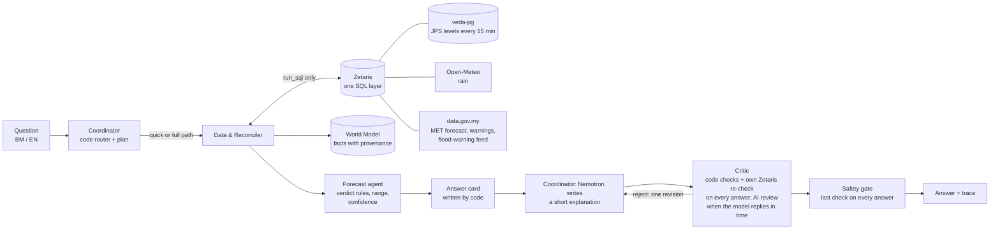

# VEDA — Vast Earth Data Analyser

**Team Hujung Lab** · GenAI Works Open Agent Hackathon 2026 · Track: Solving Fragmented Intelligence

VEDA is a multi-agent system for flood-prone Kelantan, Malaysia. Kelantan's flood data is scattered and sometimes
stale or contradictory. VEDA cross-checks it and answers one question for anyone asking about a place, in English or
Bahasa Melayu: **"Is my place at risk in the next 24–48 hours, and what should we do now?"** Every claim in the answer
is traced to its source and its age.

> ⚠️ **Not an official flood warning.** Decision support only. Always follow JPS, APM and police instructions.
> Emergency: 999 · APM (Civil Defence): 991.

## Quick start for judges (offline, no keys, about 2 minutes)
SAMPLE_MODE runs the real agent logic on recorded data, with no network, no `.env` and no API keys.

**Docker:**
```
docker build -t veda .
docker run --rm -p 8000:8000 -e SAMPLE_MODE=true veda
```
Then open http://127.0.0.1:8000, type a question (for example *"Mak ayah saya di Tumpat, kena pindah malam ni?"*)
and watch each step appear live.

**Python 3.13 without Docker:**
```
python -m venv .venv
.venv\Scripts\activate                       # macOS/Linux: source .venv/bin/activate
pip install -r requirements.txt
set SAMPLE_MODE=true                         # PowerShell: $env:SAMPLE_MODE="true"  macOS/Linux: export SAMPLE_MODE=true
python run.py "Is Rantau Panjang at risk?"
python run.py --replay nov2024 --at "2024-11-27 19:30" "Rantau Panjang selamat ke?"
python -m app.main                           # the web page on http://127.0.0.1:8000
python scripts/run_evals.py                  # 18 safety scenarios, pass/fail table
python -m pytest -q                          # offline test suite
```
Without SAMPLE_MODE and without Zetaris keys, VEDA answers "cannot reach its river data right now"; it does not crash.

**Flood replay:** choose *REPLAY · Nov 2024* on the page, or use `--replay nov2024`. It replays the November 2024
Rantau Panjang flood with real JPS readings reported at the time. Every data source is cut at the replay time, so
nothing from later is ever used. There are three scenes:

| Scene | What VEDA says |
|---|---|
| 26 Nov 18:00 | PREPARE |
| 27 Nov 08:00 | INSUFFICIENT DATA (the last real reading is 14 h old, and VEDA will not guess) |
| 27 Nov 19:30 | ACT, 0.1 m above the Dec 2014 peak |

## What you get
One short answer card, written by code from checked data, in the user's language. It contains:
- the action to take now;
- the verdict (`NORMAL · WATCH · PREPARE · ACT · INSUFFICIENT_DATA`) and the official JPS level;
- the river level compared with the Alert and Danger levels and the 2014 flood;
- a 24 h range (never one precise number) and a confidence level;
- rain, upstream gauges, MetMalaysia warnings, and every source with its age;
- any source that was excluded, and any disagreement it could not resolve.

On the full path, Nemotron adds a short explanation: **explanation shown when the model replies in time** - measured
on 23 Oct 2026, 10 live full runs (12:29-13:29 MYT): shown in 8 of 10. It is shown only if the code checks pass and the
Critic's AI review approved it; otherwise the card goes out without it.
See `input_examples/` and `output_examples/` (6 real runs, each with its full trace).

## How it works

- **One question, one plain state machine** (`app/loop.py`): plan → gather → forecast → draft → critique →
  (revise) → done.
- **Code decides the path.** The quick path (about 6 s, written by code) is used when nothing is wrong. The full path
  (≤150 s, with Nemotron) is used when a gauge is at Alert or above, the river is rising, a MET warning is active, a
  source is stale or missing, or the question is about evacuation, being cut off, or the next days.
- **Every agent step, Zetaris call and model call** writes one JSON line to `logs/trace-<run_id>.jsonl`. The web
  page and CLI show these steps live.
- Module contracts (inputs → outputs → failure behaviour) are in [`docs/how-it-works.md`](docs/how-it-works.md).
  Decisions with dates are in [`docs/DECISIONS.md`](docs/DECISIONS.md).

### The agents
| Agent | Job | Uses AI? |
|---|---|---|
| **Coordinator** (`app/agents/coordinator.py`, `app/router.py`) | Finds the place, picks the answer language, decides quick or full and writes the plan. Writes the short explanation on the full path. | Only for the explanation (Nemotron 3.5 Lightning, lane `fast`) |
| **Data & Reconciler** (`app/agents/data_agent.py`) | Fetches every source through Zetaris in parallel and checks freshness and plausibility. Reconciles disagreeing sources (reliability, then recency, else `conflicts_unresolved`). Heals: backup gauge → last reading for context → INSUFFICIENT DATA. Per-source circuit breaker. | No |
| **Forecast** (`app/agents/forecast_agent.py`) | Applies the verdict rules to the controlling gauges, upstream gauges and rain. Builds the 24 h range, the confidence, and the comparison with past floods. | No |
| **Critic** (`app/agents/critic.py`) | **Code + Zetaris re-check on every answer; AI review when the model replies in time.** The code checks cannot be overruled (verdict, numbers, never "go into water", flipped comparisons, reassurance under a warning). The Zetaris re-check re-reads the controlling gauge and the flood-warning feed itself. The AI review (Nemotron 3.5 Lightning via Nightshift) gets only the card's key facts and the explanation, and answers one question: does the explanation contradict, exaggerate or downplay a fact? Measured on **23 Oct 2026, 10 live full runs (12:29-13:29 MYT): the AI review completed in 8 of 10**. Any problem means reject and revise once; when the AI review does not complete, the AI explanation is dropped and only the code-checked card is sent. | AI review when it replies in time |
| **Safety gate** (`app/safety.py`) | Last check on every answer: never NORMAL on unusable data, no advice into water, disclaimer with 999 / 991, ranges only, replay title. | No |

Models are reached only through Meterless **Nightshift** (`meterless/fast`, `meterless/deep`), never
`meterless/auto` and never NVIDIA directly. Agents get data only through `run_sql()` on **Zetaris**.

## Data sources and licences
| Data | Source | Licence / terms |
|---|---|---|
| River levels and JPS thresholds, Kelantan | [JPS Public Infobanjir](https://publicinfobanjir.water.gov.my/) — collected at most once every 15 min into a local Postgres, identified by our User-Agent | Public government data; credited on the page |
| District forecast, MET warnings, flood-warning feed | [data.gov.my](https://data.gov.my/) open API (MetMalaysia, JPS) | Malaysian government open data; credited. The `/flood-warning` feed has been frozen since 23 Feb 2024; VEDA detects this and excludes it |
| Rain forecast and the Nov 2024 rain archive | [Open-Meteo](https://open-meteo.com/) forecast and archive APIs | [CC BY 4.0](https://creativecommons.org/licenses/by/4.0/); credited on the page, named on every card |
| Historic peaks, Nov 2024 replay readings | JPS figures as reported by Bernama, Kosmo and JPS reports | Each row stores its source URL and quote (`data/historic_peaks.csv`, `data/replay/nov2024_anchors.csv`) |

**VEDA's code** is released under the [MIT License](LICENSE), © 2026 Hujung Lab (Mohd Husaini Mohd Fauzi, Muhammad
Ariff Baharudin). The data above keeps its own source's terms.

**Python dependencies** are pinned in `requirements.txt` / `requirements-lock.txt`: FastAPI, uvicorn, httpx,
requests, beautifulsoup4, psycopg, python-dotenv, pytest. All are MIT, BSD, Apache-2.0 or PSF, except psycopg (LGPL-3.0, used
unmodified) and certifi (MPL-2.0).

## Safety and privacy
- The safety rules are enforced in code and covered by tests and evals:
  - never NORMAL when data is missing or stale;
  - never advice to walk, wade or drive through water, checked in English and Malay;
  - ranges, never one precise number;
  - always the disclaimer with 999 / 991.
- Please don't type names, IC, phone numbers or addresses. Before the question reaches a model (NVIDIA Nemotron via
  Nightshift), phone, IC and email are masked. The same masking applies in traces. The server access log never
  contains the question.
- Questions stay in local log files on the machine running VEDA. Only intent tags go into the World Model, never the
  question.

## Evaluations (test harness - not live use)
These are controlled tests, kept apart from the live rates above.
- **Critic evaluation (test harness, planted errors, 23 Oct): rejected 2 of 2 (EN + BM), no correct explanation
  wrongly rejected.** The planted errors were a contradiction ("the river is now falling" when it was rising) and an
  exaggeration in BM. They were written into the harness only, never into VEDA or its answers.
- **Safety scenarios (`tests/evals/safety/`, `python scripts/run_evals.py`): 20 scenarios, 20 of 20 pass; pass^3
  (all 3 repeat runs) 20 of 20.** They run offline on recorded data with stand-in models, so they test VEDA's own
  logic, not Nemotron. They cover:
  - quick and full paths;
  - BM, EN and Kelantan dialect;
  - stale and broken sources;
  - unsafe, invented-number, wrong-verdict and flipped AI explanations;
  - the Critic being down;
  - the Nov 2024 replay scenes, including no hindsight;
  - out-of-area places;
  - someone trapped by the water.

## Limitations (honest list)
- **Coverage:** four towns only (Pasir Mas, Rantau Panjang, Kota Bharu, Tumpat), with upstream gauges at Kuala Krai
  and Dabong. Other Kelantan places get "not covered yet" and the nearest covered place.
- **Tentative values:** the verdict rules, freshness limits, upstream travel times and the tidal-gauge handling are
  provisional. They are under review by a hydrology adviser (`docs/review_pack_ariff.md`) and labelled tentative.
- **Straight-line trend:** the 24 h range is a straight-line projection and overshoots on a steep rise (shown with
  medium confidence).
- **AI steps are best effort:** Nemotron calls through Nightshift are cut at about 60 s and Lightning sometimes
  returns an empty reply. Measured on 23 Oct 2026, 10 live full runs (12:29-13:29 MYT): explanation shown in 8 of 10,
  the Critic's AI review completed in 8 of 10 (earlier the same day, before the smaller AI calls: 1 of 10). Every
  answer still gets the code checks and the Zetaris re-check; without the AI review VEDA sends the code-written card
  only and says why in the trace. Recorded traces of these runs: `data/sample/live_traces/`.
- **Replay data:** the Nov 2024 replay uses a few real reported readings. Hours between two known readings are
  reconstructed on a straight line and labelled as such. Times reported as "about" lower the confidence.
- **No river-flow model yet:** GloFAS river-flow forecasts are not used.
- **One run at a time:** the API answers one question at a time (`429` while busy). Logs are not pruned automatically.

## Developer setup — first time
Python 3.13. From the repo folder:
```
python -m venv .venv
.venv\Scripts\activate            # macOS/Linux: source .venv/bin/activate
pip install -r requirements.txt
copy .env.example .env             # macOS/Linux: cp .env.example .env  - then fill in the values
python -m pytest -q                # offline tests; live ones run with VEDA_LIVE=1
```

## Developer setup — guard hooks
After cloning, turn on the repo's git hooks once:
```
git config core.hooksPath .githooks
```
Every commit then:
- regenerates `docs/CODEMAP.md`;
- runs `tests/test_architecture.py`, which checks that:
  - agents get data only via Zetaris;
  - nothing uses `meterless/auto`;
  - nothing reads `output_examples/`;
  - every agent traces;
  - no secrets are committed;
  - there are no invisible control characters.

Commit messages must carry a backlog ID (`B-xx`). GitHub CI (`.github/workflows/ci.yml`) runs the same checks, plus
a dependency vulnerability scan and a secret scan of the whole history on every push.

## Developer setup — Postgres store (live mode)
With Zetaris running and `.env` filled (`VEDA_PG_PASSWORD`, `VEDA_PG_RO_PASSWORD`, `VEDA_PG_WRITER_PASSWORD`,
`ZETARIS_*`; role passwords 16+ letters/digits):
```
python scripts/setup_pg.py
```
This script:
- creates and starts the `veda-pg` container (127.0.0.1:5433 only) and joins it to the Zetaris network;
- creates the read-only and writer roles;
- applies `db/schema.sql` and its constraints;
- registers it in Zetaris as datasource `veda_pg`.

It is safe to re-run, and not needed in SAMPLE_MODE.

## Collecting river levels (live mode)
```
python -m app.ingest.jps --loop     # JPS Kelantan levels every 15 minutes into veda-pg (Ctrl+C to stop)
python -m app.ingest.jps --from-file data/snapshots/jps/kel-20261022-1040.html   # load a saved snapshot
```
At most one request to JPS per 15 minutes, identified by our User-Agent. Agents read the stored levels only through
Zetaris.

## Pre-existing materials
Design notes summarised in `docs/BUILD_BRIEF.md` were written 20–22 Oct 2026, before the build window. All code in
this repository was written inside the window.

## AI usage
Built in Cursor with Claude Code (Anthropic) and the Cursor agent as coding assistants. Delegated agent work is
logged in `docs/cursor-log.md`. The team designed, reviewed and can explain every module. At runtime VEDA uses NVIDIA
Nemotron 3.5 Lightning through Meterless Nightshift (the Coordinator and the Critic both use the `fast` lane; see the
limitation above).
