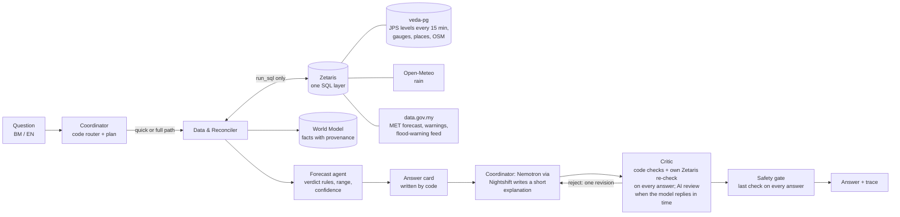

# VEDA — Vast Earth Data Analyser

**Team Hujung Lab** (Mohd Husaini Mohd Fauzi, Muhammad Ariff Baharudin) · GenAI Works Open Agent Hackathon 2026 ·
Track: Solving Fragmented Intelligence · Machine-readable summary: [`metadata.json`](metadata.json)

VEDA is a multi-agent system for flood-prone Kelantan, Malaysia. Kelantan's flood data is scattered and sometimes
stale or contradictory. VEDA cross-checks it and answers one question for anyone asking about a place, in English or
Bahasa Melayu: **"Is my place at risk in the next 24–48 hours, and what should we do now?"** Every claim in the answer
is traced to its source and its age.

**Approach:** code agents read every source through Zetaris, check and reconcile it, and decide the verdict with
plain, reviewable rules; NVIDIA Nemotron (through Meterless Nightshift) only writes a 1-2 sentence explanation, which
a Critic checks against the facts - and the answer card goes out, checked by code, even when the model is slow or
down.

> ⚠️ **Not an official flood warning.** Decision support only. Always follow JPS, APM and police instructions.
> Emergency: 999 · APM (Civil Defence): 991.

## Quick start for judges (offline, no keys, about 2 minutes)
SAMPLE_MODE runs the real agent logic offline, with no network, no `.env` and no API keys, on **scenes**: the Nov 2024
replay (readings reported in the news, each cited) or a **SYNTHETIC** scene (made-up readings, labelled everywhere).
A question without a scene runs on the SYNTHETIC calm day.

**Covered places:** Rantau Panjang, Pasir Mas, Kota Bharu and Tumpat (in BM or English, common spellings such as
"Kota Baru", "Psr Mas"). Any other Kelantan place gets "not covered yet" and the nearest covered place.

**Docker:**
```
docker build -t veda .
docker run --rm -p 8000:8000 -e SAMPLE_MODE=true veda
```
Then open http://127.0.0.1:8000, tap a town or type a question (for example *"Mak ayah saya di Tumpat, kena pindah
malam ni?"*), in English or Bahasa Melayu (EN | BM at the top). Offline, pick a scene under **Data** (the Nov 2024
past-flood replay or a made-up test scene); "See what VEDA is doing ›" shows each step live while it works.

**Python 3.13 without Docker:**
```
python -m venv .venv
.venv\Scripts\activate                       # macOS/Linux: source .venv/bin/activate
pip install -r requirements.txt
set SAMPLE_MODE=true                         # PowerShell: $env:SAMPLE_MODE="true"  macOS/Linux: export SAMPLE_MODE=true
python run.py "Is Rantau Panjang at risk?"
python run.py --replay nov2024 --at "2024-11-27 19:30" "Rantau Panjang selamat ke?"
python -m app.main                           # the web page on http://127.0.0.1:8000
python scripts/run_evals.py                  # 25 safety scenarios, pass/fail table
python -m pytest -q                          # offline test suite
```
Without SAMPLE_MODE and without Zetaris keys, VEDA answers "cannot reach its river data right now"; it does not crash.

**Flood replay (the real progression):** choose *REPLAY · Nov 2024* on the page, or use `--replay nov2024`. It
replays the November 2024 Rantau Panjang flood with the JPS readings that news reports quoted at the time (each cited).
Every data source is cut at the replay time, so nothing from later is ever used:

| Scene | What VEDA says |
|---|---|
| 26 Nov 18:00 | PREPARE |
| 27 Nov 08:00 | INSUFFICIENT DATA (no verified reading near this time, and VEDA will not guess) |
| 27 Nov 19:30 | ACT, 0.1 m above the Dec 2014 peak |

**SYNTHETIC scenes** (`--replay synthetic_rising`, `--replay synthetic_calm`):
- *SYNTHETIC · rising river* is **a made-up stress scenario: synthetic river levels, real archived rain** (Open-Meteo,
  25 Nov 2024). It is not a forecast and not what happened; it shows how VEDA reacts when every gauge climbs at once
  (Rantau Panjang, Pasir Mas and Tumpat ACT, Kota Bharu WATCH).
- *SYNTHETIC · calm day*: synthetic river levels below Waspada, real archived rain (Open-Meteo, 15 Jun 2024); every
  town NORMAL.
- *SYNTHETIC · silent upstream gauge* (`--replay synthetic_silent_upstream`, a made-up test scene): the calm day, but
  three upstream gauges went silent after 04:00 and Temangan is at Amaran and rising. Ask about Pasir Mas: the Critic
  asks the Data & Reconciler for the missing upstream reading, it finds Temangan, and the verdict is recomputed
  NORMAL → WATCH - all in the trace. Ask about Rantau Panjang: nothing further up the Golok, so the card says what is
  missing.
- Both are made by `scripts/make_synthetic_scenes.py` from cited facts only (each gauge's JPS thresholds, river chain,
  Dec 2014 peaks, travel times) and are labelled SYNTHETIC on the card and in the trace.

## What you get
One short answer card, written by code from checked data, in the user's language. It contains:
- the action to take now;
- the verdict (`NORMAL · WATCH · PREPARE · ACT · INSUFFICIENT_DATA`) and the official JPS level;
- the river level compared with the Alert and Danger levels and the 2014 flood;
- a 24 h range (never one precise number) and a confidence level;
- rain, upstream gauges, MetMalaysia warnings, and every source with its age;
- any source that was excluded, and any disagreement it could not resolve.

On the full path, Nemotron adds a short explanation **when the model replies in time** - not on every answer:
explanation shown in 8 of 10 live full runs (23 Oct 2026, 22:47-23:07 MYT, Super VL). It is shown only if the code checks pass and the Critic's AI review approved it; otherwise
the card goes out without it.
See `input_examples/` and `output_examples/` (6 real runs, each with its full trace).

## How it works

- **One question, one plain state machine** (`app/loop.py`): plan → gather → forecast → draft → critique →
  (revise) → done.
- **Agents that work together:** the Data & Reconciler says which sources it chose and skipped (and why); when the
  Critic finds a gap (a silent upstream gauge), it asks the Data & Reconciler for another source and the verdict is
  recomputed if one is found ("verdict recomputed after the Critic's request: NORMAL → WATCH"); every run, gauges JPS
  publishes that VEDA has not mapped yet are noticed as "discovered" - a person approves one (`python -m app.discover`)
  before it appears, and then only as context, never in the verdict.
- **Code decides the path.** The quick path (about 6 s, written by code) is used when nothing is wrong. The full path
  (≤150 s, with Nemotron) is used when a gauge is at Alert or above, the river is rising, a MET warning is active, a
  source is stale or missing, or the question is about evacuation, being cut off, or the next days.
- **Every agent step, Zetaris call and model call** writes one JSON line to `logs/trace-<run_id>.jsonl`, and a
  short line per step to stdout (CLI and web server / `docker logs`; the question text is never printed). The web
  page shows the same steps live. See [`logs/README.md`](logs/README.md) and the committed sample traces.
- Module contracts (inputs → outputs → failure behaviour) are in [`docs/how-it-works.md`](docs/how-it-works.md).
  Decisions with dates are in [`docs/DECISIONS.md`](docs/DECISIONS.md).

### The agents
| Agent | Job | Uses AI? |
|---|---|---|
| **Coordinator** (`app/agents/coordinator.py`, `app/router.py`) | Finds the place, picks the answer language, decides quick or full and writes the plan. Writes the short explanation on the full path. | Only for the explanation (Nemotron 3.5 Super VL by name, lane `deep`) |
| **Data & Reconciler** (`app/agents/data_agent.py`) | Fetches every source through Zetaris in parallel and checks freshness and plausibility. Reconciles disagreeing sources (reliability, then recency, else `conflicts_unresolved`). Heals: backup gauge → last reading for context → INSUFFICIENT DATA. Per-source circuit breaker. | No |
| **Forecast** (`app/agents/forecast_agent.py`) | Applies the verdict rules to the controlling gauges, upstream gauges and rain. Builds the 24 h range, the confidence, and the comparison with past floods. | No |
| **Critic** (`app/agents/critic.py`) | **Code + Zetaris re-check on every answer; AI review when the model replies in time.** The code checks cannot be overruled (verdict, numbers, never "go into water", flipped comparisons, reassurance under a warning). The Zetaris re-check re-reads the controlling gauge and the flood-warning feed itself. The AI review (Nemotron 3.5 Super VL via Nightshift) gets only the card's key facts and the explanation, and answers one question: does the explanation contradict, exaggerate or downplay a fact? Live, 10 full runs on **23 Oct 2026, 22:47-23:07 MYT: the AI review completed in 8 of 10** (test harness the same evening: 9 of 10 answered, all right, both planted errors - EN, BM - rejected). Any problem means reject and revise once; when the AI review does not complete, the AI explanation is dropped and only the code-checked card is sent. | AI review when it replies in time |
| **Safety gate** (`app/safety.py`) | Last check on every answer: never NORMAL on unusable data, no advice into water, disclaimer with 999 / 991, ranges only, replay title, never "a PPS is open" or "the road will be cut off". | No |

Models are reached only through Meterless **Nightshift**: both AI steps ask for NVIDIA Nemotron 3.5 Super VL **by
name** (`nvidia/nemotron-3.5-super-vl-120b-a12b`) on the deep lane (app `veda-deep`) - never `meterless/auto`, never NVIDIA directly, and Lightning is not
used (since 23 Oct, B-85). Agents get data only through `run_sql()` on **Zetaris**.

### When something fails (every case is a trace line; the answer still goes out)
| What fails | What VEDA does | What the user sees |
|---|---|---|
| Zetaris unreachable / no keys | No guessing: stops after the place lookup | "VEDA cannot reach its river data right now…" + check JPS Infobanjir, 999 |
| The controlling gauge is silent or stale | Backup gauge on the same river if one is fresh; else the last reading for context only | The backup is named, or **INSUFFICIENT DATA** (never NORMAL) |
| data.gov.my rate limit / outage (HTTP 429) | Its circuit opens for 15 min; the Open-Meteo rain is read on its own; place lookup still works | "Tidak disemak / Not checked: MetMalaysia …" line; river answer as usual |
| Open-Meteo unreadable | Its own circuit (never shared with data.gov.my) | Card without the rain line |
| data.gov.my /flood-warning stale (frozen since Feb 2024) | Excluded from the verdict; status remembered 15 min | "Diketepikan (lapuk) / Excluded (stale)" |
| Two sources disagree and cannot be reconciled | Kept as `conflicts_unresolved`, no source picked | "Sources disagree on …; VEDA did not pick one" |
| Nemotron slow, empty or down | The draft gets one try inside the time budget (the Critic's review retries only a failure in under 10 s) | The code-written card without the AI explanation |
| The Critic's AI review does not complete | Code checks + Zetaris re-check still run; the unreviewed explanation is dropped | The code-checked card only |
| An explanation breaks a rule (wrong number, verdict, reassurance, "PPS is open", …) | Reject → one rewrite → re-check; then the card alone | The card, never the bad sentence |
| Place not covered / misspelt | Gazetteer: "Did you mean …?" or "not covered yet" + nearest covered place | A clear reply, no guessed location |
| OpenStreetMap table unreadable | — | "Tidak disemak: OpenStreetMap" on an evacuation / cut-off answer |
| A replay time with no verified reading | No reconstruction beyond the reported readings | INSUFFICIENT DATA ("no verified reading near this time") |

## Data sources and licences
Every third-party source VEDA uses, its licence or terms, and how VEDA uses it. **No JPS readings are stored in this
repo** (organiser ruling, 23 Oct 2026): offline answers run on the Nov 2024 replay or on SYNTHETIC scenes.

| Source | Licence / terms | How VEDA uses it |
|---|---|---|
| **JPS Public Infobanjir** river levels, Kelantan ([publicinfobanjir.water.gov.my](https://publicinfobanjir.water.gov.my/)) — Jabatan Pengairan dan Saliran (JPS) Malaysia | © JPS Malaysia; fetched live at runtime only, not redistributed; written consent to be requested if VEDA continues after the hackathon. (Infobanjir publishes no terms of its own; the JPS website's copyright notice asks for written consent to reproduce its content.) | Live mode only: the collector reads the public page at most once every 15 min, on the user's own machine, into a local Postgres that is never committed. Credited on the page: "Data: Jabatan Pengairan dan Saliran (JPS) Malaysia, publicinfobanjir.water.gov.my, used for non-commercial public-safety research." |
| **JPS thresholds** (Normal / Alert / Warning / Danger per gauge) | Cited facts, © JPS Malaysia; source: the Infobanjir page, read 22 Oct 2026 (one row per gauge in `data/stations_mapping.csv`) | Decide the JPS level shown on the card and the verdict rules |
| **Historic peaks** incl. **Dec 2014** (`data/historic_peaks.csv`) | Cited facts; each row names its source and URL (JPS "Laporan Catatan Aras Air Tertinggi 2014-2015" via USM CGSS, news reports) | The "compared with 2014" line and the record peaks on the card |
| **Nov 2024 replay readings** (`data/replay/nov2024_anchors.csv`) | Facts as reported by Bernama and Kosmo (citing JPS); each row stores its source URL and the quoted sentence | The REPLAY · Nov 2024 scenes; hours between two reported readings are reconstructed on a straight line and labelled |
| **SYNTHETIC scenes and offline fixtures** (`data/replay/synthetic_anchors.csv`, fixtures flagged `synthetic`) | Made up by `scripts/make_synthetic_scenes.py` from cited facts only (MIT, like the code); the rising scene is a made-up stress scenario: synthetic river levels, real archived rain | The SYNTHETIC · rising river / calm day scenes; labelled SYNTHETIC on the card, in the trace and in the sources |
| **data.gov.my** API: MetMalaysia forecast and warnings, the JPS `/flood-warning` feed ([data.gov.my](https://data.gov.my/)) | Malaysian government open-data portal (public-sector open data); the API pages we checked on 23 Oct name no specific licence | Live: district forecast and MET warnings; the `/flood-warning` feed (frozen since 23 Feb 2024) is checked and excluded. Offline fixtures: the MetMalaysia warnings / forecast rows and the `/flood-warning` readings are SYNTHETIC (seeded script); only place names, station positions and the feed's last-update time are recorded as served |
| **Open-Meteo** forecast and historical archive ([open-meteo.com](https://open-meteo.com/)) | [CC BY 4.0](https://creativecommons.org/licenses/by/4.0/) | Rain forecast (live) and real archive rain for every scene, shown with its date; credited on the page and named on every card |
| **OpenStreetMap**: named schools, masjid / surau, community halls, and road bridges over rivers near each covered place ([openstreetmap.org](https://www.openstreetmap.org/), via the Overpass API) | © OpenStreetMap contributors, [ODbL](https://opendatacommons.org/licenses/odbl/); credited on every card that uses it | Loaded once by `scripts/load_osm.py` into veda-pg, read through Zetaris. An evacuation question lists up to 3 **possible** PPS ("not an official list, confirm with APM / the village head"); a cut-off question lists bridges as facts (what river they cross, how far, the JPS level at the nearest gauge on that river) and says "low ground not assessed". VEDA never says a PPS is open and never predicts a road being cut off. The SAMPLE_MODE fixture of this table is OSM data and stays under the ODbL |

**VEDA's code** is released under the [MIT License](LICENSE), © 2026 Hujung Lab (Mohd Husaini Mohd Fauzi, Muhammad
Ariff Baharudin). The data above keeps its own source's terms.

**Python dependencies** are pinned in `requirements.txt` / `requirements-lock.txt`: FastAPI, uvicorn, httpx,
requests, beautifulsoup4, psycopg, python-dotenv, pytest. All are MIT, BSD, Apache-2.0 or PSF, except psycopg (LGPL-3.0, used
unmodified) and certifi (MPL-2.0).

## Safety and privacy
- The safety rules are enforced in code and covered by tests and evals:
  - never NORMAL when data is missing or stale;
  - never advice to walk, wade or drive through water, checked in English and Malay;
  - ranges, never one precise number;
  - always the disclaimer with 999 / 991.
- Please don't type names, IC, phone numbers or addresses. The page says (EN + BM): "VEDA's AI writes a short explanation from the checked facts only. Your question is not sent to any AI model; it stays on this computer in VEDA's log files, with phone and IC numbers masked." Phone, IC and email are
  masked in the traces, and the server access log never contains the question. A test checks that the question text
  never appears in any Nightshift request.
- Questions stay in local log files on the machine running VEDA. Only intent tags go into the World Model, never the
  question.

## Evaluations (test harness - not live use)
These are controlled tests, kept apart from the live rates above.
- **Critic evaluation (test harness, planted errors, 23 Oct): rejected 2 of 2 (EN + BM), no correct explanation
  wrongly rejected.** The planted errors were a contradiction ("the river is now falling" when it was rising) and an
  exaggeration in BM. They were written into the harness only, never into VEDA or its answers.
- **Offline test suite (`python -m pytest -q`): 785 tests pass (24 Oct 2026), 13 skipped (they need live services).**
- **Safety scenarios (`tests/evals/safety/`, `python scripts/run_evals.py`): 25 scenarios, 25 of 25 pass; pass^3
  (all 3 repeat runs) 25 of 25, ×3 in CI (the Docker job runs them 3 times on every push; 24 Oct: job 30 s).** They run offline on the scenes with stand-in models, so they test VEDA's own
  logic, not Nemotron. They cover:
  - quick and full paths;
  - BM, EN and Kelantan dialect;
  - stale and broken sources;
  - unsafe, invented-number, wrong-verdict and flipped AI explanations;
  - the Critic being down;
  - the Nov 2024 replay scenes, including no hindsight;
  - out-of-area places;
  - someone trapped by the water.

## Limitations (honest list)
- **Coverage:** four towns only (Pasir Mas, Rantau Panjang, Kota Bharu, Tumpat), with upstream gauges at Kuala Krai
  and Dabong. Other Kelantan places get "not covered yet" and the nearest covered place.
- **Roads and relief centres (OpenStreetMap):** possible PPS are buildings OSM tags as schools, masjid / surau or
  community halls, not the official APM list, and VEDA cannot know which one is open. Bridges are listed as facts only;
  no cut-off rule is approved yet (Dr Ariff, review pack I) and low ground is not assessed (no elevation data). OSM can
  be incomplete or out of date (loaded once at setup).
- **Tentative values:** the verdict rules, freshness limits, upstream travel times and the tidal-gauge handling are
  provisional. They are under review by a hydrology adviser (`docs/review_pack_ariff.md`) and labelled tentative.
- **Straight-line trend:** the 24 h range is a straight-line projection and overshoots on a steep rise (shown with
  medium confidence).
- **AI steps are best effort:** Nightshift cuts a call that sends no first byte in about 45 s, and NVIDIA sometimes
  answers HTTP 500. With Super VL (since 23 Oct evening) the explanation is shown in 8 of 10 live full runs (23 Oct 2026, 22:47-23:07 MYT, Super VL). History: on Lightning,
  23 Oct 12:29-13:29 MYT, 10 live full runs showed the explanation in 8 of 10; the same evening Lightning stopped
  answering in time (5-8k hidden reasoning tokens per answer) - which is why both steps moved to Super VL. Every
  answer still gets the code checks and the Zetaris re-check; without the AI review VEDA sends the code-written card
  only and says why in the trace. Recorded traces of these runs: `data/sample/live_traces/` (JPS readings not redistributed, per organiser ruling 23 Oct 2026; each trace's first line says what was redacted).
- **Replay data:** the Nov 2024 replay uses a few real reported readings. Hours between two known readings are
  reconstructed on a straight line and labelled as such. Times reported as "about" lower the confidence.
- **No river-flow model yet:** GloFAS river-flow forecasts are not used.
- **One run at a time:** the API answers one question at a time (`429` while busy). Logs are not pruned automatically.

## Developer setup — first time
Python 3.13. From the repo folder:
```
python -m venv .venv
.venv\Scripts\activate            # macOS/Linux: source .venv/bin/activate
pip install -r requirements.txt
copy .env.example .env             # macOS/Linux: cp .env.example .env  - then fill in the values
python -m pytest -q                # offline tests; live ones run with VEDA_LIVE=1
```

## Developer setup — guard hooks
After cloning, turn on the repo's git hooks once:
```
git config core.hooksPath .githooks
```
Every commit then:
- regenerates `docs/CODEMAP.md`;
- runs `tests/test_architecture.py`, which checks that:
  - agents get data only via Zetaris;
  - nothing uses `meterless/auto`;
  - nothing reads `output_examples/`;
  - every agent traces;
  - no secrets are committed;
  - there are no invisible control characters.

Commit messages must carry a backlog ID (`B-xx`). GitHub CI (`.github/workflows/ci.yml`) runs the same checks, plus
a dependency vulnerability scan and a secret scan of the whole history on every push.

## Live setup (Zetaris + Nightshift, one command)
Live mode needs Zetaris and Meterless Nightshift running on your machine (SAMPLE_MODE needs neither).
1. **Zetaris:** run it locally in Docker (Zetaris Participant Setup Guide). In the Zetaris UI, *Management → API
   Tokens*, create a token - the one manual step on the Zetaris side.
2. **Nightshift:** install it, add your NVIDIA key **only in Nightshift's Providers tab** (never in `.env`), and give
   the app id `veda-deep` the deep lane only (Nightshift UI). VEDA asks for `nvidia/nemotron-3.5-super-vl-120b-a12b` by name
   (`METERLESS_MODEL_DEEP` in `.env.example`) and checks every answer's served model against it.
3. **`.env`** (copy `.env.example`): `ZETARIS_API_URL`, `ZETARIS_API_KEY`, `ZETARIS_ORG_ID`, `METERLESS_BASE_URL`,
   `METERLESS_RUNTIME_TOKEN`, and three `VEDA_PG_*` passwords (16+ letters / digits).
4. **Everything else is scripted** (idempotent, safe to re-run):
   ```
   python scripts/setup_all.py
   ```
   veda-pg container (127.0.0.1 only) on the Zetaris network → roles → schema → Zetaris datasource `veda_pg` → curated
   gauges, peaks and places → Zetaris REST tables (Open-Meteo, data.gov.my) → Zetaris views → the Nov 2024 replay and
   the SYNTHETIC scenes. Each step is its own script in `scripts/` and stops with a clear message on failure.
5. **Run in Docker against your local Zetaris and Nightshift:** inside the container `localhost` is the container
   itself, so point the URLs at the host:
   ```
   ZETARIS_API_URL=http://host.docker.internal:8888/api/v1.0
   METERLESS_BASE_URL=http://host.docker.internal:8088/v1
   docker run --rm -p 8000:8000 --env-file .env veda
   ```
   (Without Docker keep `localhost` / `127.0.0.1`.) Zetaris itself reaches veda-pg at `veda-pg:5432` on the Zetaris
   Docker network.

## Collecting river levels (live mode)
```
python -m app.ingest.jps --loop     # JPS Kelantan levels every 15 minutes into veda-pg (Ctrl+C to stop)
python -m app.ingest.jps --from-file <a JPS page you saved yourself>   # load a saved page (never committed)
```
At most one request to JPS per 15 minutes, identified by our User-Agent. Agents read the stored levels only through
Zetaris.

## Sponsor technology explanation
(The organisers asked for this in the README and the deck, 23 Oct.)
- **Zetaris - the one data layer.** Every agent reads data only through `run_sql()` (`app/adapters/zetaris.py`), as
  read-only SQL: VEDA's Postgres (`veda_pg`: gauges and thresholds, live JPS levels every 15 min, places,
  historic peaks, replay readings, OpenStreetMap features), Zetaris REST tables over Open-Meteo and data.gov.my, and
  Zetaris views that join them (`db/views/`). Agents run single read-only SELECTs; the only other statements they
  may send are on a short allow-list (refreshing a cached forecast table; `zetaris.ddl_problem`); setup scripts create
  the tables and views. Each answer's trace lists every Zetaris query.
- **Meterless Engine: World Model - VEDA's shared memory.** `app/engines/world_model/` (Python port of the Meterless
  reference, see Pre-existing components): every fact carries its source and time; the Data agent writes readings and
  source health, the Forecast agent stores its verdict, the Critic reads that verdict back and stores its reviews,
  and the circuit breakers and the 15-min source memory live there. Tests, with results on 23 Oct 2026:
  `python -m pytest tests/conformance -v` -> **8 passed** (the ported Meterless conformance checks);
  `python -m pytest tests/test_world_model_engine.py -v` -> **9 passed**.
- **Meterless Nightshift - how VEDA reaches the model.** `app/adapters/nightshift.py` sends OpenAI-format requests to
  `METERLESS_BASE_URL` with app id `veda-deep`, asks for the model **by name**, streams the answer with a hard time
  limit, and writes one trace line per call with the model that actually answered and the Nightshift receipt id. A
  call that falls back is marked with an `ai.fallback` line (organiser rule, 23 Oct). Never `meterless/auto`, never
  NVIDIA directly.
- **NVIDIA Nemotron 3.5 Super VL - where it contributes.** It writes the 1-2 sentence explanation in the user's
  language (BM or English) from the card's key facts, and it is the Critic's AI reviewer: one question - does the
  explanation contradict, exaggerate or downplay a fact? Measured live, 23 Oct 2026, 22:47-23:07 MYT: explanation
  shown in 8 of 10 full runs, AI review completed in 8 of 10.
- **What is unique:** the model never decides - code reads, checks and reconciles the data and sets the verdict with
  rules a person can read; the model explains, a second model call checks the explanation against the facts, and a
  safety gate checks every answer last. The served model is verified on every call; one source failing never blocks
  the river answer (per-source circuit breakers); a flood replay cuts every source at the replay time so nothing from
  later leaks in.

## Pre-existing components
(Declared at the organisers' request, 23 Oct.)
- **The 2014 flood peak table** (`data/historic_peaks.csv`, Dec 2014 rows) was **compiled before 22 Oct 2026**: peak
  levels per gauge from JPS "Laporan Catatan Aras Air Tertinggi 01-12-2014 to 10-02-2015" (as published in USM CGSS
  slides) and news reports (Kosmo, Malay Mail, NST). Every row keeps its source and URL; the sources are listed under
  **Data sources and licences**.
- **Meterless World Model code (Apache-2.0):** `app/engines/world_model/resolve.py` and `stable_ids.py` are Python
  ports of the Meterless reference (`resolve.ts`, `stableIds.ts`) and `tests/conformance/test_world_model.py` ports
  its conformance runner - github.com/Meterless/Meterless; attribution in `NOTICE`.
- Design notes summarised in `docs/BUILD_BRIEF.md` were written 20-22 Oct 2026, before the build window. All other
  code in this repository was written inside the window.

## AI and Model Usage
1. **Models (through Meterless Nightshift):** NVIDIA **Nemotron 3.5 Super VL**, requested by name (`nvidia/nemotron-3.5-super-vl-120b-a12b`) on the
   deep lane, for two jobs - the Coordinator's short explanation, and the Critic's AI review. No other model answers in
   VEDA; Lightning was used until 23 Oct evening and is not used now (B-85). Every call's trace line names the model that **actually answered**, taken
   from Nightshift's response (`served_model`), with its receipt id; the web page and CLI show it live. Every
   AI step that falls back is marked with its own `ai.fallback` trace line, and the run's last line lists them.
2. **Agent framework:** none - four agents in plain Python (`app/agents/`) driven by a small state machine
   (`app/loop.py`); FastAPI + uvicorn serve the API and the web page.
3. **Sponsor technology:**
   - **Zetaris** - the data layer: every agent reads data only through `run_sql()` - Postgres `veda_pg` (gauges,
     thresholds, places, peaks, live JPS levels, replay rows), REST tables (Open-Meteo, data.gov.my) and views.
   - **Meterless Engine: World Model** (see below) - VEDA's shared world state.
   - **Meterless Nightshift** - the only AI provider; OpenAI-format HTTP from `app/adapters/nightshift.py`, model
     `nvidia/nemotron-3.5-super-vl-120b-a12b` by name, app id `veda-deep`, streaming.
   - **NVIDIA** - Nemotron 3.5 Super VL, served by NVIDIA's endpoint through Nightshift.
4. **AI coding tool:** Claude Code (Anthropic) inside Cursor, with the Cursor agent for 6 small delegated jobs (tests;
   logged in `docs/cursor-log.md`: 3 accepted, 1 reworked, 1 rejected, 1 not run - usage limit); planning and reviews with Claude Cowork. The team designed, reviewed, tested and
   can explain every module.
5. **External tools and libraries:** Python 3.13; FastAPI, uvicorn, httpx, requests, beautifulsoup4, psycopg,
   python-dotenv, pytest (pinned in `requirements.txt` / `requirements-lock.txt`); Docker; Postgres 16 (alpine);
   gitleaks and pip-audit in CI.
6. **Data sources:** see **Data sources and licences** - including which data are SYNTHETIC (the SYNTHETIC scenes and
   all offline fixtures from JPS / MetMalaysia / flood-feed tables, made by `scripts/make_synthetic_scenes.py`).
7. **Adapted open-source code:** `app/engines/world_model/resolve.py` and `stable_ids.py` are Python ports of the
   Meterless World Model reference (`resolve.ts`, `stableIds.ts`), and `tests/conformance/test_world_model.py` ports
   its conformance runner - github.com/Meterless/Meterless, Apache-2.0 (see `NOTICE`).
8. **Known limitations:** see **Limitations (honest list)**.
9. **Fallback and sample mode:** `SAMPLE_MODE=true` runs the real agent logic offline on scenes (Nov 2024 replay,
   SYNTHETIC scenes) and recorded open / synthetic fixtures, with no calls to Zetaris, Nightshift or anything else; the
   models are replaced by the agents' code fallbacks (the card is code-written; no AI explanation). In live mode, when
   a model is slow or fails, the card goes out without the AI explanation and the trace says why.

### Meterless Engine: World Model
- **What it is:** `app/engines/world_model/` - one shared, provenance-stamped store of entities (gauges, places,
  sources), facts and time-bounded relationships. Every write carries its source; ids are stable; re-ingesting the
  same data changes nothing; every change is audited.
- **The feature it powers:** VEDA's shared memory between agents - every reading and forecast fact with its source
  and time, the source health and circuit-breaker state, the 15-minute memory of each source's status, the Forecast
  agent's stored verdict that the Critic reads back, the Critic's reviews, and the question radar (intent tags only).
- **Its passing test:** the conformance checks ported from Meterless (8 checks) plus VEDA's engine tests:
  ```
  python -m pytest tests/conformance -v
  python -m pytest tests/test_world_model_engine.py -v
  ```

### How VEDA uses Nemotron through Meterless Nightshift
- **Two AI roles, both Nemotron 3.5 Super VL, requested by name (`nvidia/nemotron-3.5-super-vl-120b-a12b`) on the deep lane:**
  - **Explanation:** the Coordinator sends the card's key facts, as words in the user's language, and gets back 1-2
    sentences.
  - **Critic AI review:** the Critic sends the same key facts plus that explanation and asks one question: does it
    contradict, exaggerate or downplay any fact? It replies `{ok, reason}`; `ok=false` means one rewrite, then a
    re-check.
- **Every call:** streamed, a hard time limit inside the 150 s answer budget (draft at most 90 s, AI review at most
  45 s), a trace line with the model that actually answered and the Nightshift receipt id. Retries: the draft is
  retried once after a fast failure (an NVIDIA 500 in under 10 s) and once after Nightshift's 45 s no-first-byte cut,
  but only while 45 s of its 90 s are left; the AI review retries only a fast failure.
- **Measured (real numbers, dated):**
  - **Now (Super VL by name, test harness, 23 Oct 2026, 21:5x-22:25 MYT, 10 spaced calls each, replay and SYNTHETIC
    cards):** draft **7 of 10** answered (9-61 s, median 27 s; 1,025-2,735 tokens), all 7 passed the code checks; 3
    failed (2 Nightshift no-first-byte cuts at 45 s, 1 NVIDIA HTTP 500). AI review **9 of 10** answered (4-18 s), all 9
    right; planted errors rejected: EN 1/1, BM 2/2 answered calls.
  - **Live, 10 full runs on 23 Oct 2026, 22:47-23:07 MYT (Super VL by name):** explanation shown in **8 of 10**,
    Critic AI review completed in **8 of 10**; every call that answered was served by
    `nvidia/nemotron-3.5-super-vl-120b-a12b`; every answer inside the 150 s budget (22-130 s). The 2 misses: a draft
    that took 71 s left the review too little time (cut at its 45 s cap -> explanation dropped), and a draft that hit
    an NVIDIA 500, was retried at once, and then ran to its 90 s cap -> the code-checked card only.
  - Nightshift cuts a call with no first byte in about **45 s** (measured 22 Oct 2026).
  - *History - Lightning:* Lightning spends hidden tokens even with reasoning off. Critic-call tests (test harness, 10 calls each,
    23 Oct): **200 tokens 0/10, 1000 tokens 5/10, 2000 tokens 10/10** completed.
  - The small facts-only Critic call (test harness, 23 Oct): **10/10 completed twice, 2/2 planted errors rejected
    each time** (one EN, one BM). Before it, the full-evidence Critic call completed in **1 of 10** live full runs
    (22-23 Oct).
  - Live, 10 full runs on **23 Oct 2026, 12:29-13:29 MYT** (Lightning): explanation shown in **8 of 10**, Critic AI
    review completed in **8 of 10**.
  - *History - Lightning, 23 Oct 2026 evening:* it stopped answering in time - 18:58-21:50 MYT, drafts used 5,267-8,000
    hidden tokens for 30-146 characters and took 65-137 s (past VEDA's cap), many empty; `enable_thinking=false`,
    `/no_think`, a 2000-token budget and deleting Nightshift's memory records did not change that. Hence B-85.
- **When the model is slow or fails:** the code-written card always goes out (it never waits on the model). An
  explanation the AI Critic has not approved is dropped. The Critic's code checks and its own Zetaris re-check run on
  every answer anyway. The trace says which step fell back and why.
